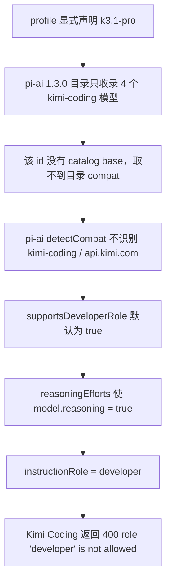

# llm-pi-ai 连接 Kimi Coding 的 compat 配置经验

记录一次反复出现的故障：`kimi-coding` 路由在发送系统提示词时被上游拒绝，报
`400: {"message":"role 'developer' is not allowed","type":"invalid_request_error"}`。
问题不在账号、密钥或网络，而在 `llm-pi-ai` 的 compat 配置层级与 pi-ai 的自动探测边界。
本文同时说明重做修复的步骤，供以后再次遇到时直接照做。

适用版本：DSH desktop 0.2.2-rc.3 / `@deepseek-ai/dsh-llm-pi-ai` 0.2.2-rc.3 /
`@earendil-works/pi-ai` 1.3.0（2026-11-16 验证）。profile 配置位于
`~/.dsh/profiles/desktop/cordis.patch.yml`，不在本仓库内。

## 结论

Kimi Coding 的 OpenAI 兼容端点不接受 `role: "developer"`，只接受 `role: "system"`。
pi-ai 目录里内建的 `k3`、`k3-256k`、`kimi-for-coding`、`kimi-for-coding-highspeed`
都已经钉死 `supportsDeveloperRole: false`；但 `k3.1-pro` 这类目录尚未收录、在
profile 中手写出来的模型 id 拿不到这份目录 compat，pi-ai 自动探测又不认识
`api.kimi.com`，于是默认 `supportsDeveloperRole: true`，配合模型声明的
`reasoningEfforts`（`model.reasoning = true`）就把系统提示词发成了 `developer`。

修复不是靠改 pi-ai，而是把 compat 写到正确的位置：**provider 级 compat 兜底，
手写模型再补 model 级 compat**。根级 `config.compat` 不生效，这是最容易踩的一层。

## 失效链路



对应的两处源码：

- `pi-ai/dist/api/openai-completions.js` 的 `detectCompat()` 与
  `instructionRole = model.reasoning && compat.supportsDeveloperRole ? "developer" : "system"`；
- `dsh-llm-pi-ai/lib/index.js` 的 `resolveModelCompat()`：模型条目先取 provider 级
  compat，再叠加 model 级 compat，最后才落到目录 base 或 pi-ai 探测。

## 两个配置陷阱

### 陷阱一：根级 `compat` 会被静默忽略

`llm-pi-ai` 的 `Config` 只声明了 `providers` 一个键：

```js
const Config = z.object({ providers: z.dict(profile).default({}).volatile() });
```

schemastery 不拒绝多余键，所以下面这种写法不会报错，插件也从不读取：

```yaml
- id: llm-pi-ai
  config:
    compat:                      # 无效：运行时只读 config.providers
      supportsDeveloperRole: false
    providers:
      kimi-coding: ...
```

所有 compat 开关必须写在 `providers.<route>.compat` 或 `providers.<route>.models[].compat`。
判断配置是否真的生效，唯一可靠的办法是看线上请求体（见“验证方法”）。

### 陷阱二：手写模型 id 不继承目录 compat

`models` 列表是“替换”而不是“追加”：每个条目只从同 id 的目录条目继承未显式声明的字段。
目录里没有 `k3.1-pro`，条目就没有 base，`resolveModelCompat()` 返回空对象，随后由
pi-ai 的 `detectCompat()` 决定。因此只要新增一个目录外的模型 id，就同时要补 compat。

反过来，目录已收录的 id（`k3` 等）即使写在 `models` 里也会继承目录 compat，
所以“老模型没问题、新加的 `k3.1-pro` 报错”是典型症状。

## 正确配置

下面是实际生效的片段（省略其他 provider 与模型条目）：

```yaml
- id: llm-pi-ai
  name: "@deepseek-ai/dsh-llm-pi-ai"
  config:
    providers:
      kimi-coding:
        compat:                        # 路由级：覆盖全部模型
          supportsDeveloperRole: false
          supportsStore: false
          maxTokensField: max_tokens
        models:
          - id: k3.1-pro
            name: K3.1 Pro
            contextWindow: 1048576
            input: [text, image]
            reasoningEfforts:
              low: low
              high: high
              max: max
            compat:                    # 模型级：补目录缺的推理相关字段
              supportsReasoningEffort: true
              thinkingFormat: openai
              requiresReasoningContentOnAssistantMessages: true
        apiKeyEnv: KIMI_CODING_API_KEY
```

各字段的作用：

| 字段 | 取值 | 原因 |
|---|---|---|
| `supportsDeveloperRole` | `false` | 系统提示词走 `system`，直接修复 400 |
| `supportsStore` | `false` | 与目录内建条目一致，不发送 `store` |
| `maxTokensField` | `max_tokens` | 目录条目使用该拼写；自动探测会发 `max_completion_tokens` |
| `supportsReasoningEffort` | `true` | K3.1 Pro 用顶层 `reasoning_effort`（`low` / `high` / `max`） |
| `thinkingFormat` | `openai` | 同上，避免落到 `deepseek` 等其它拼写 |
| `requiresReasoningContentOnAssistantMessages` | `true` | Kimi 多轮与工具调用要求原样回放 assistant 的 `reasoning_content` |

`supportsMidConvoSystemMessages` / `supportsMidConvoToolAdditions` 在 DSH 的
`compatProfile` 里没有暴露（属目录专用字段），手写模型拿不到。后果是后续系统更新
以 user 角色 reminder 发送、每次请求重发完整工具列表；功能正确，只是前缀缓存命中差一些。
这一点无法用配置补，属于 pi-ai 目录能力的边界。

## 验证方法

不要只看配置写没写，要看实际请求体。做法是起一个严格 mock：收到 `role: "developer"`
就按 Kimi 的原样返回 400，其余正常流式返回；把路由 `baseURL` 指过去，用临时
`DSH_HOME` 的 headless profile 跑一条消息，再检查抓到的 body。

```text
roles: ['system', 'user', 'user', 'user']
max_tokens: 128000 | max_completion_tokens: None
store present: False | reasoning_effort: high
```

把 `supportsDeveloperRole` 去掉再跑一次作为反向对照，DSH 会报出与线上一致的：

```text
dsh: INVALID_REQUEST: 400: {"message":"role 'developer' is not allowed","type":"invalid_request_error"}
```

这组正反对照同时证明了两件事：配置确实进入了请求组装器，mock 也确实在拦 developer。
临时 profile 只借用 `llm-pi-ai` 这一条与真实配置相同的片段，改 `baseURL` 和
`apiKeyEnv` 指向本地即可，不会碰到真实 profile 和真实密钥。

## 排查清单

1. 错误里出现 `role 'developer' is not allowed` → 先确认该模型 id 是否在 pi-ai 目录中。
   快速检查（桌面版把内容打包在 asar 里）：

   ```bash
   grep -a -c '"chat:k3.1-pro"' "/Applications/DeepSeek Harness.app/Contents/Resources/app.asar"
   ```

   输出 `0` 说明目录没收录，需要 model 级 compat。

2. 配置里有没有 `config.compat`（根级）？有就删掉，移到 `providers.<route>.compat`。
3. 修完必须看请求体确认 role 变成 `system`；只看 YAML 无法发现根级静默失效。
4. 通过 Models 页面删除再重建 provider 会丢掉手写的 compat，重建后按本文补回。
5. 海外账号用 `https://api.kimi.ai/coding/v1` 时同理：`detectCompat()` 同样不识别，
   需要同一组 compat。

## 维护与上游

- DSH 升级后先复查 pi-ai 目录是否已收录该模型 id；收录后可删掉 model 级 compat，
  但 provider 级 compat 建议保留，它对新加的手写 id 仍然有效。
- 上游的正确修法是在 `detectCompat()` 里识别 Kimi 端点（`provider === "kimi-coding"`
  或 `baseUrl` 含 `api.kimi.com` / `api.kimi.ai`），并单独设一个 Kimi 分支而不是并入
  `isMoonshot`，否则会连带关掉 K3 系列的 `supportsReasoningEffort`。
- 该问题在 pi 上游有公开记录，维护者的结论与本地复现一致：

  > “pi's built-in `kimi-coding` models (`k3`, `kimi-for-coding`, …) already set
  > `supportsDeveloperRole: false` and send `role: "system"`. A model you add yourself
  > under `kimi-coding` ... falls back to auto-detection, and auto-detection doesn't
  > recognize Kimi yet, so it sends `developer`.”
  > ——[earendil-works/pi#11365](https://github.com/earendil-works/pi/issues/11365)

- Kimi Code 官方模型表确认了 `k3.1-pro` / `k3.1-pro-highspeed` 的 id 与推理档位：

  > “Kimi Code currently offers six model IDs across K3.1 Pro (including K3.1 Pro
  > Highspeed), K3 (including its 256K context variant), K2.8 Preview, and K2.7 Code
  > Highspeed.”
  > “K3.1 Pro models, the K3 series, and K2.8 Preview support `low` / `high` / `max`
  > thinking effort levels.”
  > ——[Kimi Code 模型文档](https://www.kimi.com/code/docs/en/kimi-code/models.html)

- DSH 侧同类诉求（让 compat 开关对自建路由可配）见
  [deepseek-harness#3335](https://github.com/deepseek-ai/deepseek-harness/discussions/3335)
  与 [deepseek-harness#780](https://github.com/deepseek-ai/deepseek-harness/discussions/780)；
  结论一致：`supportsDeveloperRole` 已可配置，但必须写进 provider / model 层。
