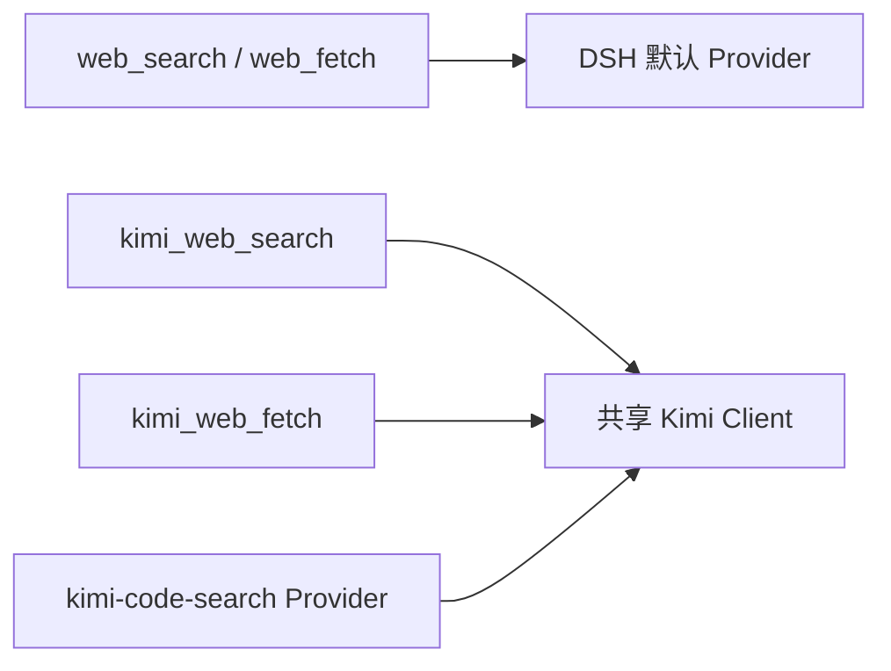

# Kimi Code Search / Fetch 接入调研

## 源码基线

- 活跃仓库：[MoonshotAI/kimi-code](https://github.com/MoonshotAI/kimi-code)。
- 本地 sparse checkout：`../../_upstream/kimi-code/`。
- 固定 commit：`fc3b521b8b68468268bb4cfe7f45008ce08b2b99`（2026-11-02）。
- 许可证：MIT。旧 `MoonshotAI/kimi-cli` 已归档，仅用于历史对照。
- 克隆仅用于静态阅读，未执行其安装或构建脚本。

## Search 协议

默认端点：

- 中国大陆：`https://api.kimi.com/coding/v1/search`
- 全球：`https://api.kimi.ai/coding/v1/search`

当前 TypeScript 客户端发送：

```json
{ "text_query": "query" }
```

> `const body = { text_query: query };` ——[moonshot-web-search.ts](https://github.com/MoonshotAI/kimi-code/blob/fc3b521b8b68468268bb4cfe7f45008ce08b2b99/packages/agent-core-v2/src/app/auth/webSearch/providers/moonshot-web-search.ts#L56-L114)

鉴权为 `Authorization: Bearer <token>`。响应读取 `search_results[]`，将 `title/url/snippet/date` 映射为 DSH 的 `title/url/snippet/publishedAt`；`content/icon/mime/site_name` 不进入答案。

旧 Python 版的 `limit/enable_page_crawling/timeout_seconds` 未进入当前实现，本插件跟随当前协议。

## Fetch 协议

默认端点：

- 中国大陆：`https://api.kimi.com/coding/v1/fetch`
- 全球：`https://api.kimi.ai/coding/v1/fetch`

请求头包含 `Accept: text/markdown`，请求体为：

```json
{ "url": "https://example.com" }
```

> `const bodyJson = JSON.stringify({ url });` ——[moonshot-fetch-url.ts](https://github.com/MoonshotAI/kimi-code/blob/fc3b521b8b68468268bb4cfe7f45008ce08b2b99/packages/agent-core-v2/src/app/web/providers/moonshot-fetch-url.ts)

HTTP 200 正文直接是提取后的 Markdown：

> `return response.text();` ——[moonshot-fetch-url.ts](https://github.com/MoonshotAI/kimi-code/blob/fc3b521b8b68468268bb4cfe7f45008ce08b2b99/packages/agent-core-v2/src/app/web/providers/moonshot-fetch-url.ts#L70-L85)

官方客户端失败后回退本地 Fetch；本插件不自动回退，避免把鉴权/限流故障转换成另一条未获明确选择的网络路径。

## 凭据与 Tool Call 归因

`KIMI_CODING_API_KEY` 是本工作区已有 DSH CredentialRef 约定。插件将 `credentials` 作为硬依赖，每次操作通过 `ctx.credentials.resolve()` 读取，由 DSH 处理存储、启动环境和 `.env` 回退。

当前 Kimi 版本的 `X-Msh-Tool-Call-Id` 可选。旧 Provider 接口无法提供该值，因此省略；新的独立工具可以从 `exec.callId` 取得真实 ID，并传给 Search/Fetch 请求。平台与设备身份头不伪造。

OAuth 文件、refresh token 轮换、原子写回和跨进程锁均不在本轮范围内。

## 独立工具架构



- 内置工具继续选择当前配置的 DeepSeek Provider。
- 两个 `kimi_web_*` 工具直接调用共享 Client，不经过全局 Provider 选择。
- 旧 `kimi-code-search` Provider 仅在 `registerLegacyProvider: true` 时启用，默认不注册，避免未固定 Provider 的 composition 出现自动选择歧义。
- 不新增全局 Fetch Provider，不修改内置工具 Schema，也不实现按次 Provider 参数。

独立工具复用 DSH 的规范化结果：Search 返回 `{sources,truncated}`；Fetch 返回 `{url,statusCode,body,truncated}`。实际 `exec.callId` 进入 Kimi 请求头，调用日志保留工具参数与展示元数据。Web Client 在 `tool.call.toolview` 注册两个 keyed 卡片，使用自己的轻量 React 视图、宿主主题令牌和中英文 locale，不加载内部 UI 包。

## 安全与兼容边界

- API 端点仅 HTTPS、无内嵌凭据；`redirect: "error"`。
- Search 结果仅保留 HTTP(S) URL，按规范化 URL 去重，并限制字段长度。
- Fetch 仅接受绝对公共 HTTP(S) URL，拒绝 userinfo、localhost 和直接给出的私有 IP；远端服务仍需承担其自身的目标安全检查。
- 原始响应上限 2 MiB，错误响应上限 16 KiB；字节读取使用预分配缓冲并集中解码。
- Fetch 模型输出默认上限 200,000 字符；`statusCode` 属于 Kimi API，不是目标站点状态。
- 无自动重试、跨区域 fallback、DeepSeek fallback、本地抓取 fallback 或 OAuth 刷新。
- 查询和 URL 会发送给 Kimi；所有搜索与网页内容都是外部不可信数据。
- 客户端仓库没有接口的公开 OpenAPI/稳定性承诺，也没有第三方使用条款或计价说明。

### WebError 在链接插件中的类身份

`dsh-tools` 只在错误 `instanceof HarnessError` 时保留结构化 code。普通 npm dependency 会让链接插件加载另一份类副本，导致该检查失败。

类身份由运行时解析保证，不是由版本号保证：`createRuntimeResolution()` 在展开 profile 依赖闭包前，先把安装自带的包名放进 `reserved`/`visited`（`collectProfileScopePackages(profile, packageNames, …)`），因此 `@deepseek-ai/dsh-web` 始终解析到 Host 自己的那份，插件目录里的 `node_modules` 在运行时不可能抢到该名字。本地 `node_modules` 只供裸 Node 单测，不进入包文件列表。

`peerDependencies` 因此只承担**兼容性门禁**职责，必须写成范围：

```json
"peerDependencies": {
  "@deepseek-ai/dsh-web": "^0.2.2-rc.1"
}
```

门禁实现见 `dsh-app-boot` 的 `unmetRequirements()`：它把该字段直接交给 `semver.satisfies(runtimeVersion, range, { includePrerelease: true })`。**精确版本号在这里等于单点范围**——`0.2.1-rc.5` 只匹配它自己，所以 DSH 任何一次升级都会让 `evaluatePluginCompatibility()` 返回 unmet，随后 `loadProfileDirectory()` 把整个 bundle 记进 `skippedBundles` 而**保留行不动、不打印**，`preflight()` 再禁用对应行；表现就是工具静默消失，GUI 里没有任何报错。`^0.2.2-rc.1` 接受 `0.2.2-rc.1`…`0.2.x`，拒绝 `0.3.x`，既不重新打开每次升级必坏的窗口，也仍然拦住真正的不兼容。

`test/package.test.js` 现在断言该字段必须保持 `^0.2.` 前缀，`src/client.js` 的 `USER_AGENT` 也由测试锁定到 `package.json` 的 `version`，两者都不再允许漂移。

## 0.2.1 适配 DSH 0.2.2-rc.1

2026-11-04：DSH 升级到 0.2.2-rc.1 后插件失效，定位与修复如下。

失效不是 API 破坏，而是上面那条兼容性门禁：插件仍以 `link:` 安装、仍留在 `dependencies`，但 `0.2.1-rc.5` 的精确 peer 让 bundle 被跳过，于是 profile 里既没有 `include:kimi-web-search` 行，也没有 `kimi_web_*` 工具。

逐一核对 0.2.2-rc.1 中插件实际使用的 API，均未破坏：

| 接口 | 0.2.2-rc.1 状态 |
|---|---|
| `ctx.web.registerSearchProvider` / `WebError` | 未变；新增可选 `provider.ready(llmProvider)`，本插件的 `available()` 语义仍适用 |
| `ctx.tools.register(definition)` | 未变；`presentCall` / `presentResult` / `output.presentationMeta` / `timeoutMs` / `isConcurrencySafe` 全部保留 |
| `ctx.tools.get(name, scope)` | 未变（新增可选 `toolSet` 参数） |
| `ctx.systemPrompt.section()` / `getSectionOrder("TOOL_WEB_SEARCH")` | 未变；`TOOL_WEB_SEARCH` 仍为 2000，`text(context)` 仍能拿到 `context.scope` |
| Client `window.__ModuleLoader__` + `slots.register({ name, key, locale })` | 未变；`tool.call.toolview` 仍提供 `useDisclosure`、`toolName`、`phase`、`block` 与 locale 座位的 `t` |

实际改动只有三处：peer 范围、`version` 升到 `0.2.1`（同步 `USER_AGENT`）、本地 dev peer 副本重装到 0.2.2-rc.1。

验收：

- `npm run check`：53 项测试在真实 `@deepseek-ai/dsh-web` / `dsh-llm` 0.2.2-rc.1 上全部通过，含 `WebError`/`HarnessError` 类身份断言。
- `plugin_manager set_bundle` 重新启用后 `application: applied`、无警告；`dsh.profile.bundles` 末位恢复 `dsh-plugin-kimi-web-search`。
- 运行中的 GUI 无需重启即完成两侧挂载：Host `Tool.listTools` 出现 `kimi_web_search` / `kimi_web_fetch`，Client `tool.call.toolview` occupant 同时出现两个 key。
- 真实调用 `kimi_web_search` 返回 4 条来源；内置 `web_search` / `web_fetch` 与 DeepSeek 的 `searchProvider` / `fetchProvider` 选择均未受影响。
- `Config.listConfigs` 中该行为 `include:kimi-web-search`（`status: unsupported` 属预期：本插件用 Standard Schema 而非 schemastery，无法投影 JSON Schema）。

### 顺带发现的陈旧状态

`~/.dsh/profiles/node_modules/@deepseek-ai/` 是一套指向已删除源码 checkout（`~/Git/deepseek-harness`）的**断链符号农场**，与本插件无关，也不参与运行时解析——0.2.2 的解析表按安装锚点优先。它属于历史残留，可在确认没有其他本地 link 依赖后清理。


## 0.1 原型验证记录

2026-11-02：

- 28 项测试通过。
- 当前 Key 对 Search API 返回 HTTP 200 和 6 条结果。
- `include:kimi-web-search` 与两个 DeepSeek Search 插件同时 active。
- Kimi 激活后，DeepSeek 内置 `web_search` 成功返回 8 条来源。
- 当前 profile 的 DeepSeek Search/Fetch 选择未改变。

后续只读审查发现的 WebError 类身份、凭据阶段超时/取消、错误正文取消、cause 泄密面、URL/去重及 chunk 开销问题，在 0.2 改造中列入基础合同修复。

## 0.2 独立工具验证记录

2026-11-02：

- `npm run check`：45 项测试全部通过，包含标准 JSON Schema、真实 WebError/HarnessError 类身份、凭据全过程取消/超时、流式字节上限、URL 校验、工具合并/展示与清理。
- 直接 Client 冒烟：Search 返回 6 条来源；Fetch 对 `https://example.com/` 返回 HTTP 200 和 918 字符提取文本。
- 实际 DSH 新 Agent 验收：`kimi_web_search` 成功返回 6 条来源，`kimi_web_fetch` 成功返回网页正文；内置 `web_search` 和 `web_fetch` 随后也分别成功，四路同时可用。
- 当前 `Tool.listTools` 同时展示 `web_search`、`web_fetch`、`kimi_web_search`、`kimi_web_fetch`。
- 当前 profile 的 `searchProvider: deepseek-search-api` 与 `fetchProvider: deepseek-fetch-api` 未改变。
- 错误路径：`kimi_web_fetch` 对 `http://127.0.0.1/` 在本地拒绝，实际会话 `tool/result` 记录 `error: { name: "WebError", code: "WEB_INVALID_URL" }`，证明 Host peer 类身份与结构化错误码保留。
- 首次重载发现直接工具注册要求标准 JSON Schema 的对象级 `required: [...]`；修正后 `application: applied`，无警告。该回归已加入测试。
- 单次样例中 Kimi Search 的结果偏向第三方 SEO 页面，而 DeepSeek 命中更多官方来源；这只是该查询的观察，不作为普遍质量结论。

本轮停在独立 Search/Fetch 工具，没有继续实现 OAuth、自动 fallback、统一 Provider 参数、双后端聚合或设置 UI。

### 对抗性审查后的收尾

独立审查指出：Web Client 不消费 Host 的 `presentCall/presentResult`，自定义名称需要 keyed Client renderer；Fetch 原字符上限只截正文；FQDN 尾点和 IPv6 过渡地址可绕过部分声明；API 200 容易误读为目标页状态；旧 Provider 在未固定选择的 composition 中可能造成歧义。

已分别加入 Client 卡片、最终完整输出上限、URL 规范化、明确的状态文案和默认关闭的旧 Provider。当前 52 项测试通过，包含 keyed 注册、locale 平衡、链接渲染、完整输出长度、URL 边界和可选 Provider。最新真实 Fetch 回归输出 `Kimi API HTTP 200; target status unavailable`，内置 Fetch 仍成功。

Client 组件已通过无 DOM 的结构测试。当前已连接 GUI 尚未刷新，因此 keyed occupant 与最终视觉呈现仍需在普通页面刷新后确认；新开的验证浏览器被 DSH 本地鉴权页拦住，没有绕过鉴权。

### 卡片排版与宿主工具行对齐

用户反馈 keyed 卡片在会话里明显比其它工具调用「大一号」、图标是品牌色、抓取图标像变形的放大镜。根因是卡片自带了一套排版：`font: inherit` 继承了会话正文的 14–15px，标题用 `--dsw-alias-label-primary`，图标用 `--dsw-alias-brand-primary`，图标本身还是「放大镜 + 两条横线」的临时画法。

宿主的行度量在 `dsh-client-ui-tool` 的 `ToolRow.module.css` 与 `DisclosureRow.module.css`（primitives）里，取值固定：行高 `calc(24px + var(--dsh-content-font-delta,0px))`、标题与摘要 `--dsh-content-font-size-secondary`（13px）、整行 `--dsw-alias-label-tertiary`、悬停 `--dsw-alias-label-secondary`、前置图标框 16px（内部 svg 14px、右外边距 6px）、标题与摘要之间是 2px 的 `--dsw-alias-label-caption` 圆点、收起时悬停把图标换成箭头。

这次没有 import `@deepseek-ai/dsh-client-ui-primitives`（内部 Client 包不在第三方插件契约里），而是把这套度量用同样的主题令牌在自己的 CSS 里复刻；两个字形直接取宿主 16px 图标网格上的 `search-outline` 与 `browse-outline` 路径（`stroke-width: 1`，与宿主 `regular` 档一致），因此 `kimi_web_search`/`kimi_web_fetch` 与内置 `web_search`/`web_fetch` 的行完全同族。展开体也改成宿主 Web 卡片的来源列表排版：`--dsw-alias-link` 的 14px/500 标题、13px 摘要、`--dsw-font-xs-13` 的时间与状态。

样式改为在 `apply` 里注入一次（`data-plugin-css` 标记 + `ctx.effect` 清理），不再每张卡片渲染一个 `<style>`。`test/client.test.js` 增加了行结构断言（`role`/`tabIndex`/`aria-expanded`、分隔点、摘要截断、preparing 不可展开），防止再次漂移。
