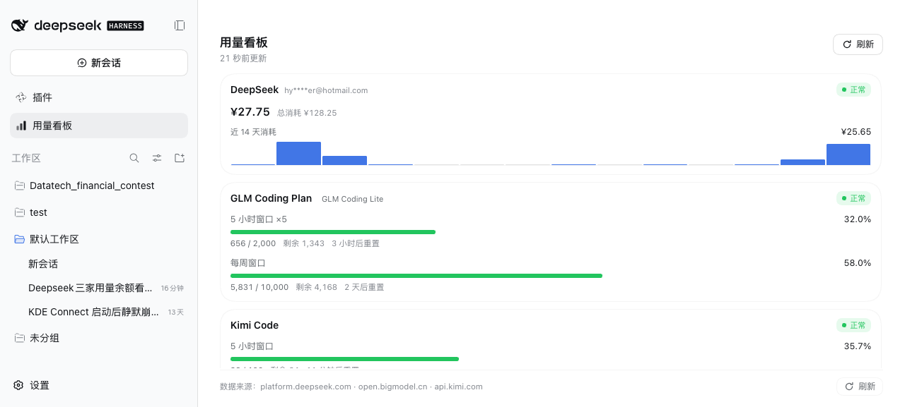

# 用量看板 · dsh-plugin-usage-board

一个 **[DeepSeek Harness](https://github.com/deepseek-ai/deepseek-harness)（DSH）插件**：在 DSH Web 界面的侧边栏里，用一块面板同时显示三家服务的**用量、额度和余额**。

| 服务 | 显示内容 | 数据来源 |
|---|---|---|
| **DeepSeek** | 账户余额、累计消耗、近 14 天每日消耗趋势 | `platform.deepseek.com` 账号接口（复用 DSH 已登录的授权） |
| **GLM Coding Plan** | 套餐名、5 小时窗口、每周窗口（已用 / 总量 / 剩余 / 重置倒计时） | `open.bigmodel.cn` 官方额度接口 |
| **Kimi Code** | 5 小时窗口、每周窗口（已用百分比 / 剩余 / 重置倒计时） | `api.kimi.com` Kimi Code 订阅接口 |

三家的数据全部来自**官方接口**，插件不做页面抓取，也不需要你手动填任何密钥——它直接读取 DSH 已经保存好的凭据。



上图是真实运行截图：DeepSeek 卡片显示余额与近 14 天消耗柱状图，GLM 卡片显示 5 小时/每周两条额度条与重置倒计时，Kimi 卡片显示同样两条额度条。

---

## 1. 安装

插件是一个标准的 DSH 插件包，安装方式就是把**本目录的绝对路径**交给 DSH。

### 方式 A：用 DSH 图形界面安装（推荐）

1. 打开 DeepSeek Harness，在左侧边栏点 **插件 / Plugins**。
2. 点 **添加插件 / Add plugin**。
3. 在输入框里粘贴本目录的绝对路径：

   ```
   /Users/songer/Documents/deepseek-harness/default-workspace/dsh-plugin-usage-board
   ```

4. 勾选信任确认框，点 **安装 / Install**。
5. 安装完成后点 **立即启用 / Enable now**。
6. DSH 会重新组装插件树，侧边栏出现 **用量看板** 一项。

> 本插件是本地路径安装（pnpm `link:`），所以之后**直接改源码即可生效**，不需要重新安装。

### 方式 B：命令行安装（DSH Desktop 关闭时）

```bash
DSH="/Applications/DeepSeek Harness.app/Contents/Resources/runtime/cli/bin/dsh"
"$DSH" plugin --profile desktop add \
  /Users/songer/Documents/deepseek-harness/default-workspace/dsh-plugin-usage-board
```

> `--profile desktop` 由桌面应用独占管理。DSH **正在运行也可以执行**（它会等锁），但
> DSH 必须先登录过一次、profile 目录已初始化。若提示
> `profile "desktop" is managed exclusively by the Electron application`，说明 DSH 完全没启动过，
> 先打开一次 DSH 再执行。

### 卸载

图形界面：插件页 → 本插件 → **卸载**。
命令行：

```bash
"$DSH" plugin --profile desktop remove dsh-plugin-usage-board
```

---

## 2. 使用

侧边栏点 **用量看板**，或用独立页面 <http://127.0.0.1:19387/usage-board/>（端口取决于 DSH 实际监听端口）。

- **自动刷新**：默认 60 秒一次；页面重新可见时立刻刷新一次。
- **手动刷新**：面板右上角 **刷新** 按钮，会强制绕过缓存重新请求。
- **每张卡片**右上角的彩色标签是这家服务的状态：绿色「正常」、灰色「未配置」、红色「未授权 / 上游错误 / 网络错误」。
- 卡片底部小字是诊断信息：实际命中的接口域名、本次请求耗时。

### 各家的具体表现

**DeepSeek** — 显示余额（¥）与累计消耗，并画出近 14 天的每日消耗柱状图。DeepSeek 官方**没有**提供「额度窗口」类接口，所以这张卡片没有进度条，只有余额和趋势。

**GLM Coding Plan** — 两条进度条：5 小时滚动窗口和每周窗口，显示「已用 / 总量」、「剩余」、「X 小时后重置」。套餐名直接取自 GLM 的订阅接口（例如 `GLM Coding Lite`）。

**Kimi Code** — 两条进度条：5 小时滚动窗口和每周窗口。Kimi Code 订阅**不提供余额接口**，所以这张卡片只有用量，没有金额。

---

## 3. 凭据从哪里来

插件**不会**向你索取密钥，也不会把密钥写到任何地方。它通过 DSH 的凭据服务读取你**已经配置好**的凭据：

| 服务 | 读取的凭据 | 在哪里配置 |
|---|---|---|
| GLM Coding Plan | `ZAI_CODING_CN_API_KEY` | DSH 设置 → 模型 / 凭据，或 `~/.dsh/.credentials.yaml` |
| Kimi Code | `KIMI_CODING_API_KEY` | 同上 |
| DeepSeek | `deepseek-account-platform/default` 账号授权记录 | 在 DSH 里登录 DeepSeek 账号后自动写入 |

只要你在 DSH 里已经能用这三家的模型，这个面板就能直接出数，**无需任何额外配置**。

### 安全边界

- 接口默认**只允许本机回环地址**访问（`allowRemote: false`）。局域网内其他机器读不到你的用量与余额。
- 任何响应、日志、错误信息里都**不会**出现完整密钥。健康检查接口只报告「是否已配置」。
- 密钥**不会**经过浏览器：网页只请求本机插件的 HTTP 接口，由插件在主机侧去调用三家的官方 API。
- 独立页面带 `Content-Security-Policy` 响应头，禁止加载任何外部资源。

---

## 4. 配置

配置写在 DSH 插件的 profile patch 层里，改完由 DSH 重新加载。

```yaml
- id: usage-board
  name: 'dsh-plugin-usage-board'
  config:
    ttlMs: 60000        # 缓存时长（毫秒），允许范围 15000–300000
    servePage: true     # 是否同时提供 /usage-board/ 独立页面
    allowRemote: false  # 是否允许非本机地址访问接口（不建议打开）
    verbose: false      # 打开后会把每次请求的结果写进 DSH 日志
```

---

## 5. 出问题时

| 现象 | 原因与处理 |
|---|---|
| 卡片显示「未配置」 | 该服务的密钥不在 DSH 凭据里。在 DSH 设置里补上对应密钥即可，不需要重启插件。 |
| GLM 显示「未授权」 | 密钥过期或不是 Coding Plan 的密钥。注意：GLM 在鉴权失败时**也返回 HTTP 200**，插件是靠响应体里的业务码判断的。 |
| GLM 提示没有 Coding Plan | 这个密钥是普通 API 计费密钥，不是编码套餐。套餐接口对非订阅用户不可用。 |
| DeepSeek 显示「未授权」 | DSH 里的 DeepSeek 登录已失效，重新登录即可。 |
| 独立页面打不开 | 检查 DSH 是否在运行，以及实际端口（`allowRemote: false` 时只接受本机访问）。 |
| 数字长时间不变 | 缓存未过期属正常；点「刷新」可强制更新。若 `verbose: true`，DSH 日志里能看到每次刷新结果。 |

自检接口：

```bash
curl -s http://127.0.0.1:19387/usage-board/api/health
```

---

## 6. 开发与验证

```bash
cd dsh-plugin-usage-board

node --test test/                  # 全部单元测试与静态检查（离线）
node test/providers.live.mjs       # 用真实凭据打三家官方接口，打印实际数值
```

架构、协议、以及为什么这样设计，见 [docs/ARCHITECTURE.md](docs/ARCHITECTURE.md)；
独立验证报告见 [docs/VERIFICATION.md](docs/VERIFICATION.md)。

---

## 7. 许可

MIT。
